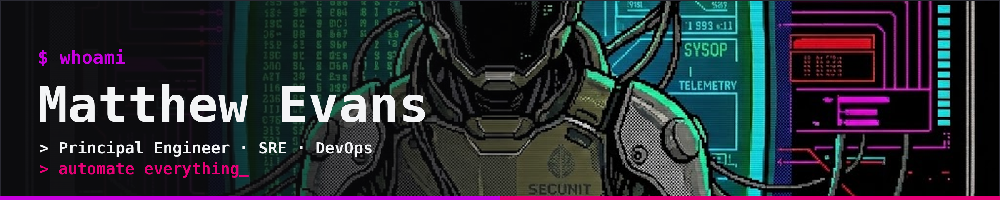
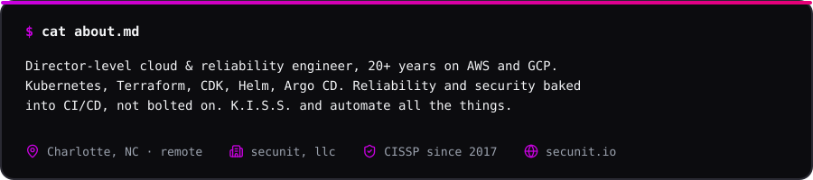
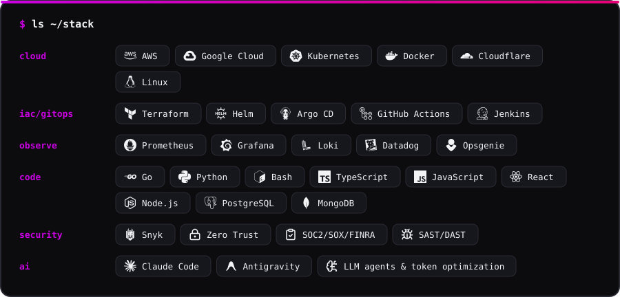
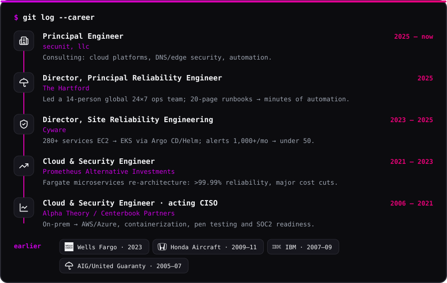
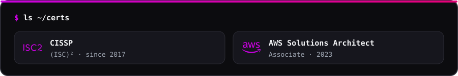

  
    
  
  
  
  

 

<table>
<tr><td align="center" width="50%"></td><td align="center" width="50%"></td></tr>
<tr><td align="center" width="50%"></td><td align="center" width="50%"></td></tr>
<tr><td align="center" width="50%"></td><td align="center" width="50%"></td></tr>
</table>

  
  

